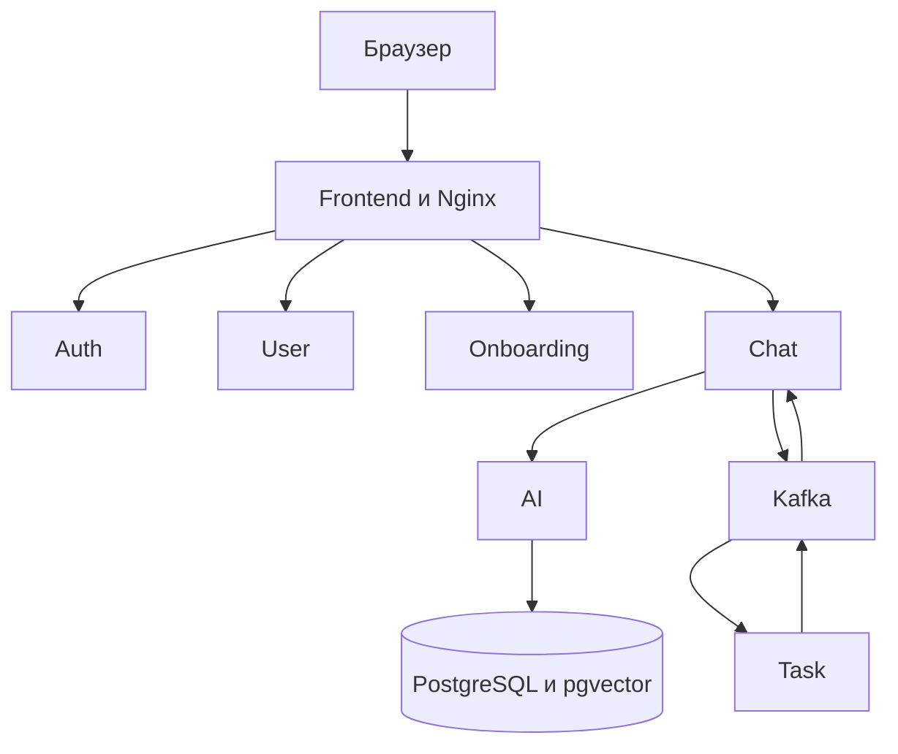

[](https://github.com/unt1tledd/avito-ai-buddy/actions/workflows/ci.yaml?query=branch%3Amain)
[](https://qlty.sh/gh/unt1tledd/projects/avito-ai-buddy)
[](https://qlty.sh/gh/unt1tledd/projects/avito-ai-buddy)

# Команда "План-капкан"
Григорович Софья Андреевна - бэкенд + тимлид

Сорокин Александр - бэкенд

Фарук Джафаров - фуллстак

Андрей Екимов - МЛ-инженер + бэкенд

Ямщиков Герман - devops-инженер + qa
# Avito AI Buddy

https://disk.yandex.ru/i/dBHLAOncAqDorQ

AI Buddy помогает стажёру пройти онбординг. В Roadmap видны шаги адаптации и прогресс, а в чате можно уточнить, как выполнить шаг, найти инструкцию или подготовить заявку на доступ.

- **Roadmap** показывает общий и профильный треки, когда они есть в назначенном плане.
- **Чат** хранит отдельные переписки. AI учитывает доступные пользователю источники и контекст онбординга.
- **Заявки** создаются после подтверждения предложения в чате. Решение по заявке обновляет её статус и возвращается в Chat.
- **Демо-режим запуска** создаёт локальный аккаунт и назначает ему Backend-план с готовыми шагами.

## Запуск

Понадобятся Docker, Docker Compose v2, Make, Bash и Python 3. Команды ниже выполняются из корня репозитория.

### 1. Настройте окружение

На новом checkout скопируте шаблон и заполните обязательные настройки из него:

```bash
cp -n .env.example .env
```

В `.env` задайте локальные пароли БД и ключи сервисов по шаблону. Для нового стенда включите справочные данные и шаблоны онбординга:

```dotenv
USER_SEED_DEMO=true
ONBOARDING_SEED_DEMO=true
```

Переменная `USER_SERVICE_TOKEN` обязательна для Compose.  User, Chat, Onboarding и Task используют одно значение внутри стенда. Храните `.env` локально!

## Команды проекта

Из корня репозитория выполните:

```bash
make help
```

Справка покажет команды по разделам: локальный стенд, мониторинг, тесты и управление контейнерами. Чтобы выполнить команду из списка, используйте `make <имя-команды>`. Например:

| Команда | Что делает |
| --- | --- |
| `make demo-up` | Поднимает стенд и создаёт демо-аккаунт с готовым Roadmap |
| `make local-monitoring` | Запускает мониторинг и выводит адрес Grafana |
| `make docker-status` | Показывает состояние контейнеров проекта |

Если у вас Линукс то для Docker нужен `sudo`, поэтому добавте после команды  `DOCKER_USE_SUDO=1`, например `make demo-up DOCKER_USE_SUDO=1`.


### 2. Подготовьте AI для ответов по базе знаний

Для проверки ответов по базе знаний добавьте в корневой `.env` профиль AI из отчёта команды по гибридному поиску. Чат использует **Artemox** и модель **`gpt-5.6-luna`**. Эмбеддинги идут через **OpenRouter → DeepInfra** с моделью **`qwen/qwen3-embedding-8b`** и размерностью **1536**.

```dotenv
LLM_BASE_URL=https://api.artemox.com/v1
LLM_MODEL=gpt-5.6-luna
LLM_API_KEY=<ваш ключ Artemox>

EMBEDDING_BASE_URL=https://openrouter.ai/api/v1
EMBEDDING_MODEL=qwen/qwen3-embedding-8b
EMBEDDING_PROVIDER=deepinfra
EMBEDDING_DIMENSIONS=1536
EMBEDDING_API_KEY=<ваш ключ OpenRouter>
```

Подставьте свои ключи вместо значений в угловых скобках. Ключи хранятся только в локальном `.env`. После согласования передачи материалов выбранным провайдерам установи `KNOWLEDGE_PROCESSING_APPROVED=true`. Подробности об импорте и требованиях к профилю описаны в [инструкции](ai/knowledge/README.md).

```bash
make local-up-new
make local-ai-status
```

make local-up-new собирает и запускает стенд, применяет миграции и обновляет базу знаний AI инструкциями по онбордингу (данные пользователей сохраняются)

Внимание загрузка будет выполняться очень долго! (от 10 до 33 минут)

### 3. Поднятие стенда с демо-пользователем

```bash
make demo-up
```

Оно выполняет `local-up`, которая поднимает локальный стенд и применяет миграции базы данных, затем запускает `infra/scripts/seed-demo.py`, который регистрирует демо-пользователя, создаёт профиль через User API, назначает план через Onboarding API и проверяет, что он содержит шаги. Повторный запуск переиспользует аккаунт и сохраняет прогресс. Ссылка, логин и пароль печатаются в терминале.

1. Откройте [локальный интерфейс](http://127.0.0.1:8085/).
2. Войди с данными из вывода `demo-up`. Если браузер уже авторизован под другим аккаунтом, то выйдите из него


## Архитектура



Nginx раздаёт React-приложение и проксирует API, Go-сервисы используют PostgreSQL для своих данных, а AI выполняет поиск по базе знаний и вызывает LLM. Kafka передаёт команды создания заявок и события об изменении их статуса.


## Микросервисы

### Auth Service (`auth/`)

- Регистрирует пользователей и проверяет учётные данные при входе.
- Выдаёт access- и refresh-токены, обновляет сессию и завершает её при выходе.
- Проверяет токены по запросу других сервисов.

### User Service (`user/`)

- Хранит профили стажёров, команды и данные стажировки.
- Позволяет пользователю создать и прочитать собственный профиль.
- Передаёт метаданные профиля сервисам Chat, Onboarding и Task. Эти сервисы используют внутренний токен для чтения.

### Onboarding Service (`onboarding/`)

- Хранит шаблоны шагов адаптации и планы, назначенные стажёрам.
- При назначении плана получает трек стажёра из User Service.
- Возвращает шаги и прогресс для Roadmap, отмечает выполнение и позволяет отменить отметку.
- Передаёт Chat Service контекст онбординга, чтобы помощник мог учитывать текущий шаг при ответе.

### Chat Service (`chat/`)

- Управляет переписками, хранит сообщения и отдаёт историю с пагинацией.
- Передаёт AI Service вопрос, историю диалога и контекст онбординга.
- Сохраняет предложенные AI черновики заявок. После подтверждения пользователем отправляет команду создания заявки через Kafka.
- Получает из Kafka события Task Service и обновляет статус заявки в чате.

### Task Service (`task/`)

- Принимает из Kafka команды на создание заявок на доступ.
- Хранит заявки и их статусы, обрабатывает решения об одобрении и отклонении.
- Возвращает пользователю список его заявок.
- Публикует события об изменении статуса через Kafka, чтобы результат появился в чате.

### AI Service (`ai/`)

- Формирует поисковый запрос с учётом вопроса, истории диалога и текущего шага онбординга.
- Ищет инструкции, доступные пользователю, сочетая текстовый поиск BM25 и векторный поиск в PostgreSQL с pgvector.
- Вызывает LLM и возвращает ответ со ссылками на использованные источники.
- По найденным правилам доступа может предложить черновик заявки, который пользователь подтверждает в чате.

### Данные и миграции

PostgreSQL хранит учётные записи, профили, Roadmap, переписки и заявки. База знаний AI хранит фрагменты документов и векторы в PostgreSQL с расширением pgvector. Локальные данные переживают остановку Compose благодаря именованным томам.

`local-up` готовит PostgreSQL, запускает миграции Auth и AI и поднимает сервисы. Наполнение шаблонами онбординга зависит от `ONBOARDING_SEED_DEMO`, а демо-профиль и персональный план создаёт `demo-up`. Для проверки первого старта используйте отдельный локальный стенд с новыми томами, а для проверки повторного запуска используйте те же тома и убедитесь, что прогресс пользователя сохранился.

## Мониторинг и логи

```bash
make local-monitoring
```

Команда поднимает **Prometheus, Blackbox Exporter, Grafana, Alloy и Loki**. Адрес Grafana выводится в терминал, порт по умолчанию — [3000](http://127.0.0.1:3000/).

| Компонент | Что делает |
| --- | --- |
| Prometheus | Собирает метрики мониторинга и вычисляет правила алертов |
| Blackbox Exporter | Проверяет `/readyz` AI по HTTP внутри сети Compose |
| Alloy | Читает логи контейнеров приложения и отправляет их в Loki |
| Loki | Хранит логи для поиска и запросов из Grafana |
| Grafana | Показывает состояние стенда и дашборды нагрузочных сценариев |

На **Home** видны готовность AI, состояние целей Prometheus, трафик Chat по методам, p95 успешных запросов и операций LLM, ошибки приложения и доставка логов **Alloy → Loki**. На дашбордах отдельных тестов данные ограничены префиксом запуска и временем из ссылки отчёта.

`up=1` для Loki означает успешный сбор метрик. Если графики прогона пустые, проверь ссылку и префикс, затем панель доставки логов и ошибки записи в Loki. Заполнение диска Docker может остановить приём новых логов при доступных метриках. Для поиска записей конкретного теста открой **Explore → Loki** и подставь его префикс:

```logql
{service="chat"} |= "ПРЕФИКС_ПРОГОНА"
```

Дашборды хранятся в `infra/grafana/dashboards/`. После изменения генератора обнови JSON и перезапусти Grafana:

```bash
python3 tests/load/make-dashboard.py
docker compose --profile observability restart grafana
```

## Проверки

### Локальные линтеры и тесты

Для запуска вне Docker понадобятся Go и `golangci-lint` для Go-сервисов, Python и `uv` для AI, Node.js 20 и npm для фронтенда. Сначала установите зависимости фронта командой `npm ci --prefix frontend`.

```bash
make lint-go
make lint-py
make lint-fr
```


### Интеграционные тесты

```bash
make integration-test
make integration-test-list
make integration-test-one TEST=TestAuthLifecycle
```

Интеграционные тесты проверяют взаимодействие сервисов. Среди сценариев есть жизненный цикл сессии, создание и чтение профиля, изоляция истории чатов, подтверждение заявок и обратные уведомления через Kafka.

### Нагрузочные тесты

Для запуска нужны работающий локальный стенд, Python 3 и `k6` в `PATH`.

```bash
make load-test-list  # Показать нагрузочные сценарии и их описания
```

#### Запуск тестов

| Команда | Что запускает |
| --- | --- |
| `make load-test-one TEST=имя_сценария` | Один сценарий. Имя возьмите из `make load-test-list` |
| `make load-test` | Полное нагрузочное тестирование |


#### Как узнать `LOAD_TEAM_ID`

`LOAD_TEAM_ID` — ID существующей команды в сервисе User. Скрипт привязывает к
ней тестовые профили. Переменная нужна для всех сценариев, кроме `history`
и `pagination`.

Для локального стенда с `USER_SEED_DEMO=true` можно использовать демо-команду
Backend:

```bash
export LOAD_TEAM_ID=900001
```

Чтобы посмотреть команды на своём стенде, выполните из корня репозитория:

```bash
docker compose exec -T db psql -U postgres -d users \
  -c 'SELECT team_id, name FROM users.teams ORDER BY team_id;'
```
Возьмите `team_id` нужной тестовой команды и подставь его в `export LOAD_TEAM_ID=...`.
Если список пуст, то  включите `USER_SEED_DEMO=true` и запустите стенд с демо-данными.

Для `task`, `recovery` и полного `make load-test` также экспортируйте
`TASK_TRACKER_TOKEN` со значением, которое использует локальный Task.
Compose читает `.env` для настройки контейнера, а скрипт нагрузки читает
переменные окружения текущего запуска.

#### Настройка нагрузки

Флаги отдельного сценария передаются через `LOAD_ARGS='...'`.

| Флаг | Что меняет |
| --- | --- |
| `--rates` | Интенсивность ступеней через запятую. Для `history` и `pagination` — запросы в секунду, для остальных сценариев — итерации в минуту |
| `--seconds` | Длительность каждой ступени в секундах |
| `--history-rps` | Частоту параллельного чтения истории в `mixed`, `mock` и `soak` |
| `--offline` | Использование локального тестового провайдера для AI-сценариев. Это поведение по умолчанию |

`--rates` и `--seconds` можно менять для отдельных сценариев, кроме
`recovery`. AI-сценарии с заглушкой временно переключают сервис на тестовую
БД и локального провайдера. После прогона скрипт возвращает обычную конфигурацию.


После запуска скрипт выводит итог k6, ссылку на Grafana и путь к
`index.html` в `~/k6-reports/`. Из оглавления можно открыть сводку,
логи и дашборд каждой ступени. Если тест упал, начните с `k6.log` первой
неуспешной ступени. Ошибки подготовки контейнеров ищите в `setup.log`.

## CI и работа с pull request

- **GitHub Actions** запускает проверки из [`.github/workflows/ci.yaml`](.github/workflows/ci.yaml). Workflow генерирует protobuf, проверяет Go, AI и Frontend, собирает Docker-образы и запускает интеграционные проверки. Отчёты покрытия сохраняются в артефакты `coverage-go`, `coverage-ai` и `coverage-frontend`.
- **Qlty** получает отчёты покрытия из CI. По отчёту PR можно открыть покрытие изменённых строк и посмотреть, какие файлы дали пропуски. Токен загрузки хранится в GitHub Actions Secrets под именем `QLTY_COVERAGE_TOKEN`. Оформление PR и локальные тесты выполняются независимо от отображения бейджа. Бейдж CI вверху относится к `main`, а процент в Qlty появляется после загрузки отчёта для ветки по умолчанию.
- **Dependabot** предлагает обновления зависимостей в отдельных PR. Смотри изменения версий и результаты CI перед слиянием.
- **Шаблон PR** подсказывает, как описать изменение, выполненные проверки и детали для ревью. Для изменения интерфейса пригодится скриншот, для изменения API или миграции — краткая инструкция по проверке.

Перед открытием PR запустите проверки затронутых компонентов. Если изменение касается запуска, проксирования через Nginx или нескольких сервисов, проверьте сценарий на локальном стенде и укажи в PR команду и результат.
